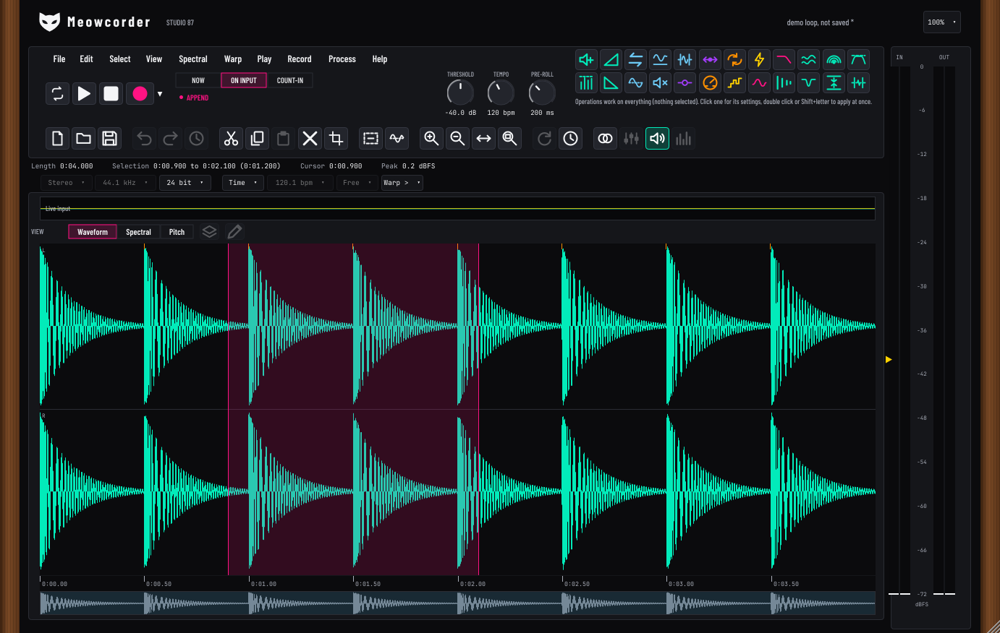

# Meowcorder

<p align="center"></p>
<p align="center"><sub>The plugin editor rendered offscreen with a demo loop (tools/snapshot.cpp).</sub></p>

<p align="center"><a href="https://ko-fi.com/studio87"></a></p>

A free audio recorder and editor for Linux first (also Windows and macOS): record from a track or input, cut and process the sound, drop it back. Made for quick sound design in the middle of a project. Part of the Studio 87 cat plugin suite.

## Status
Source version 0.4 (pitch view and warp); the only GitHub release so far is v0.2.0, a pre-release. See the [web page](docs/index.html) for the screenshot, manual and mockup.

Plugin builds so far: the engine is done (pure C++, 619 passing checks) and the plugin now exists as VST3 and standalone, with the window ported from the mockup (`docs/mockups/Meowcorder.html`, open it in any browser to see the full design). Installers and a tested release are still to come, see [ROADMAP](ROADMAP.md) and the [manual](https://github.com/SpeakingColors/Meowcorder/blob/main/docs/Meowcorder_manual.pdf).

What works in the plugin today: record from the track or input (start now, on input or after a four click count-in, pre-roll, grab the last seconds heard, mono or stereo takes), waveform with selection and zoom, spectral view with the Mouse, Select, Scissors, Cutter, Copy, Paste and Amp tools, pitch view (piano roll: drag a note to change its pitch), warp and transpose (stretch, repitch, beats, texture, formants), undo and redo with a history list to jump to any step, cut, copy, paste, delete, crop, snap to zero, all 24 operations with their settings and a Preview button, play and loop, open (WAV, AIFF, FLAC, OGG) and save as WAV (16, 24 or 32 bit float), drop a file on the window, resizable window.

Not in this build yet (the buttons are there, greyed out): host tempo sync, the spectral eraser and pencil, and the overlay and split views. The waveform pencil works (Shift+Q): zoom in until you see single samples, then drag over the wave; one stroke is one undo step. The tempo of a sound is detected and shown.

## What the finished window does (mockup)
- Its own Edison-style history: undo, redo, repeat the last operation (Ctrl+Shift+Z), and jump to any step. Separate from your DAW.
- Process popups with knobs, a Mix amount, and Apply to Selection (default) or Whole sound
- Waveform, Spectral and Pitch views: one at a time, or together as overlay or split; the view in front gets the edits and the others follow live
- Spectral tools (selector, scissors, cutter, eraser, copy, paste, amp) and a Pencil that draws tones; a waveform pencil that draws samples at high zoom
- Piano roll pitch view: drag notes to change the pitch
- Timing: time, seconds, samples or bars; tempo detection, Free or Sync to host, four warp modes, transpose, fine tune, formants, Bake in
- Clickable sound info: channels (mono mix, left, right, swap, mid/side), sample rate (convert or set) and bit depth (with dither)
- Configurable Play keys (start from the beginning, resume, from the cursor)
- Record trigger: the arrow in the meter is the level that starts a recording in On input mode (same as the Threshold knob)

## What the engine does
- Recorder that is always listening: immediate or threshold start, pre-roll (the sound just before you pressed record), capture of the last seconds without recording
- Editor with selection, cursor, undo and redo with a history list to jump to any step, cut, copy, paste, delete, crop, snap to zero crossing, punch in, insert and append recordings
- 24 operations on the selection (or the whole sound): gain, normalize, fades, reverse, invert, DC remove, silence, make mono, balance, pitch and speed, bitcrusher, Drive (Drive, Transistor, Fuzz as in PurrOne), EQ, filter, delay, chorus, phaser, reverb, compressor, limiter, noise gate, trim silence, make loop
- Repeat last operation
- WAV in (8, 16, 24, 32 bit, float 32 and 64) and out (16, 24, 32 float)
- Peak overview, spectrogram and hit detection for the display

## Build and test
```
sh tests/run.sh
```
Remake the manual and its screenshots from the mockup: `node tools/shoot_tour.js && python3 tools/make_manual.py` (needs playwright with chromium, and reportlab).

## Support
Free and open source. If you like it, you can support it on [Ko-fi](https://ko-fi.com/studio87). Nothing is locked and nothing is collected.

## License
AGPL-3.0-or-later, see [LICENSE](LICENSE).
